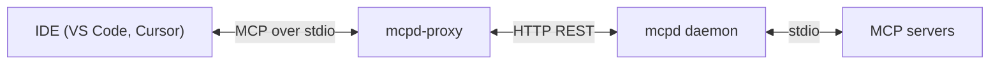

# IDE Integration

[`mcpd-proxy`](https://github.com/mozilla-ai/mcpd-proxy) is an MCP server that puts every server
`mcpd` manages in front of an IDE as a single connection.

An IDE expects to speak MCP over stdio and to manage each server itself. `mcpd` speaks HTTP and
already manages the servers. The proxy sits between the two, so the IDE configuration stays one
entry no matter how many servers `.mcpd.toml` declares.



Tools, resources, and prompts from every server are aggregated into one MCP interface. The proxy
holds no configuration of its own beyond the daemon address.

---

## Prerequisites

- [Node.js](https://nodejs.org) 22.10.0 or later.
- A running `mcpd` daemon. See [Installation](installation.md).

The proxy is published to npm, so `npx` fetches it on demand and nothing needs installing first.

---

## Configuration

The proxy reads two environment variables:

| Variable       | Description                                | Default                 |
|----------------|--------------------------------------------|-------------------------|
| `MCPD_ADDR`    | Address of the `mcpd` daemon API           | `http://localhost:8090` |
| `MCPD_API_KEY` | API key, when the daemon requires one      | _(not set)_             |

### VS Code

Add a server to your MCP settings file:

```json
{
  "servers": {
    "mcpd": {
      "type": "stdio",
      "command": "npx",
      "args": ["@mozilla-ai/mcpd-proxy"],
      "env": {
        "MCPD_ADDR": "http://localhost:8090"
      }
    }
  }
}
```

Reload the window (`Developer: Reload Window`), then check the MCP panel for the aggregated tools.

### Cursor

Add the same server to `.cursor/mcp.json` in the project, or `~/.cursor/mcp.json` to apply it
everywhere:

```json
{
  "mcpServers": {
    "mcpd": {
      "command": "npx",
      "args": ["@mozilla-ai/mcpd-proxy"],
      "env": {
        "MCPD_ADDR": "http://localhost:8090"
      }
    }
  }
}
```

Reload Cursor to pick up the change.

---

## Naming

Two servers can offer a tool of the same name, so the proxy qualifies everything it exposes with the
server that provides it:

|           | Exposed as                       | Example                             |
|-----------|----------------------------------|-------------------------------------|
| Tools     | `{server}__{tool}`               | `time__get_current_time`            |
| Prompts   | `{server}__{prompt}`             | Same convention as tools            |
| Resources | `mcpd://{server}/{resource_uri}` | `mcpd://filesystem/documents/a.txt` |


**Refresh the IDE after changing the server list**

The proxy does not yet notify an IDE when the set of tools changes. After `mcpd add` or a daemon
restart, reload the IDE window so it requests the tool list again.


---

## Troubleshooting

If the IDE reports no tools, confirm the daemon is reachable at the address the proxy was given:

```bash
curl -s http://localhost:8090/api/v1/servers
```

A failure here is a daemon problem rather than a proxy one, so continue in
[Troubleshooting](troubleshooting.md). If the daemon responds and the IDE still shows nothing, check
the IDE's own MCP logs, as the proxy reports startup failures on `stderr`.
